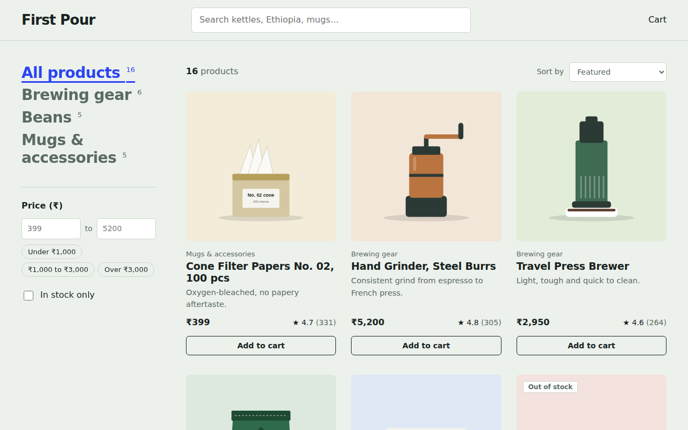
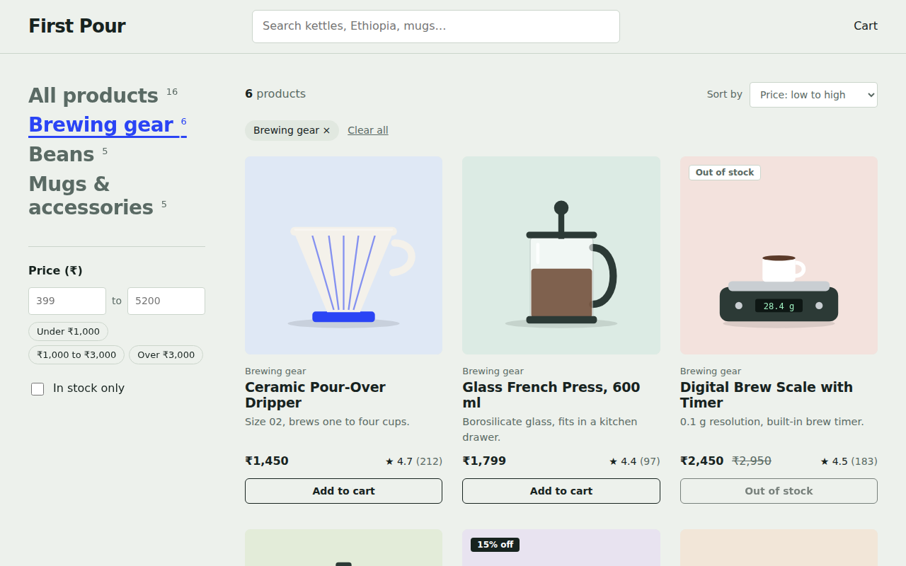
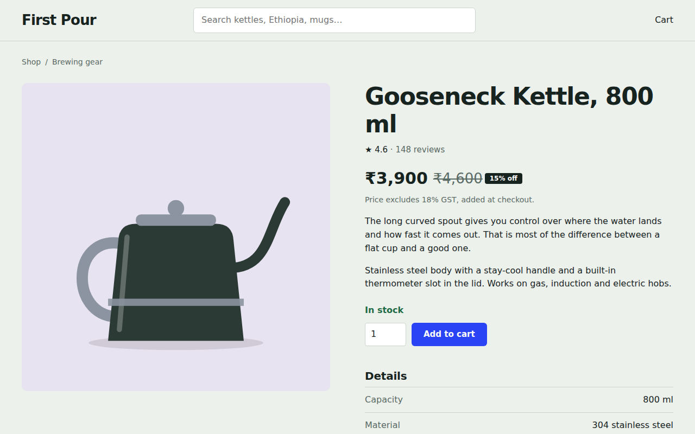
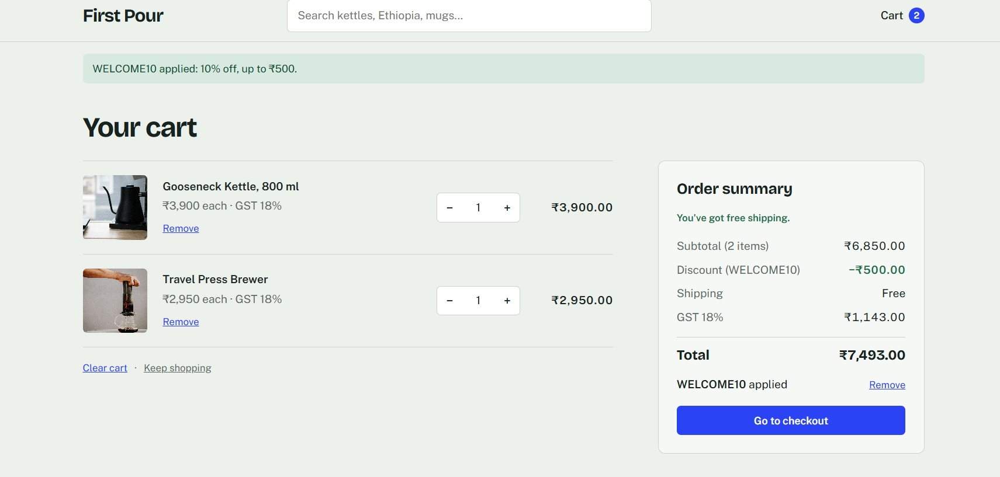
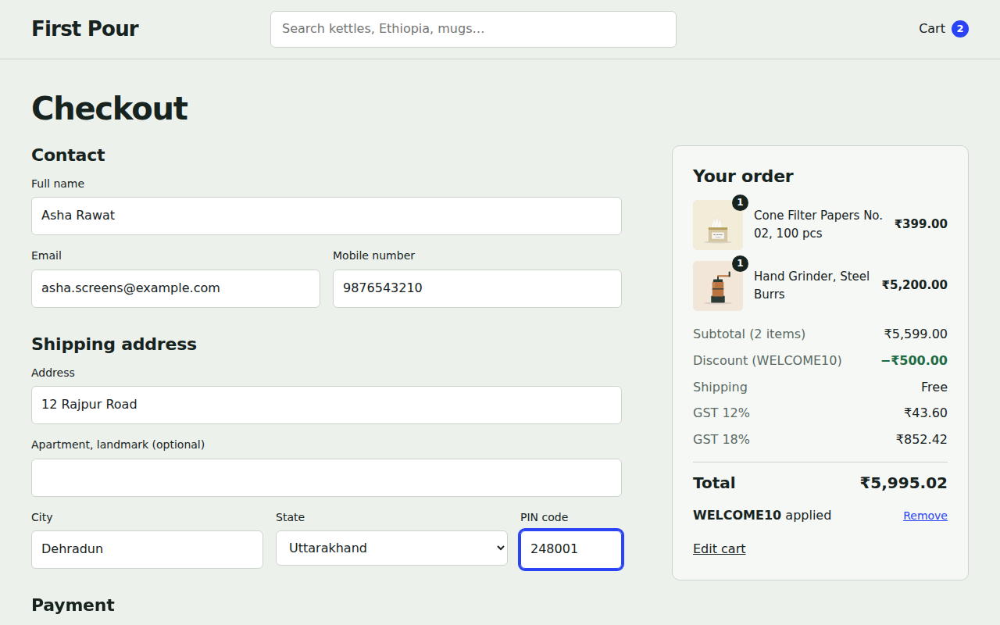
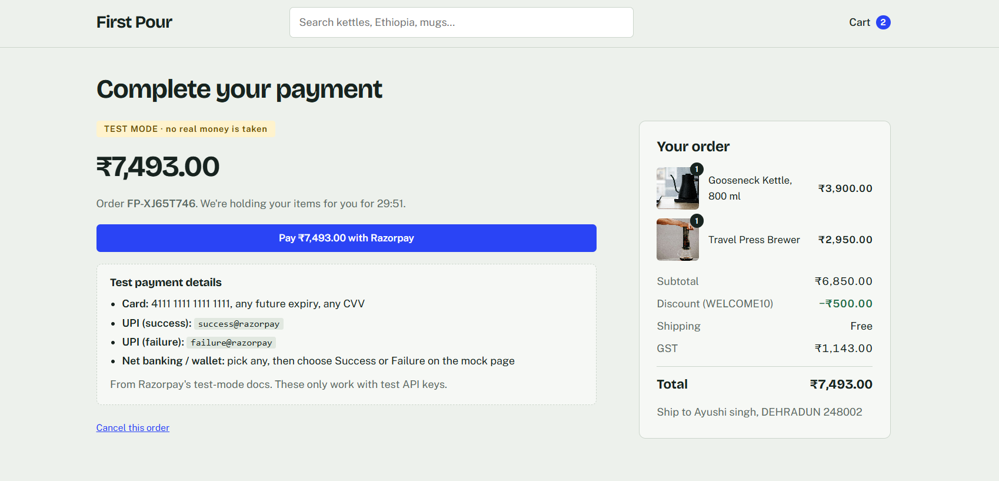
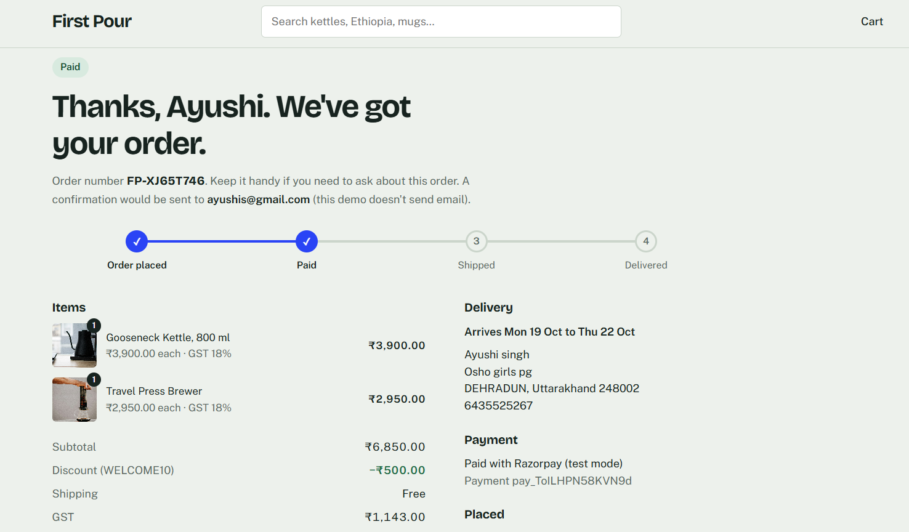
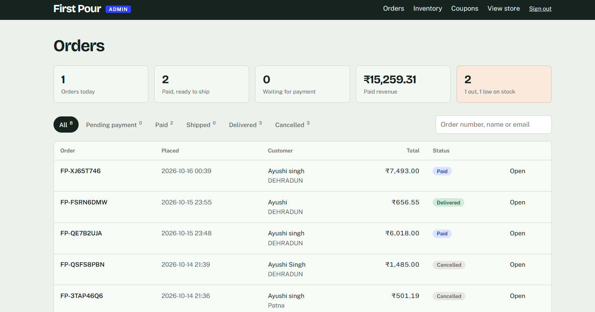
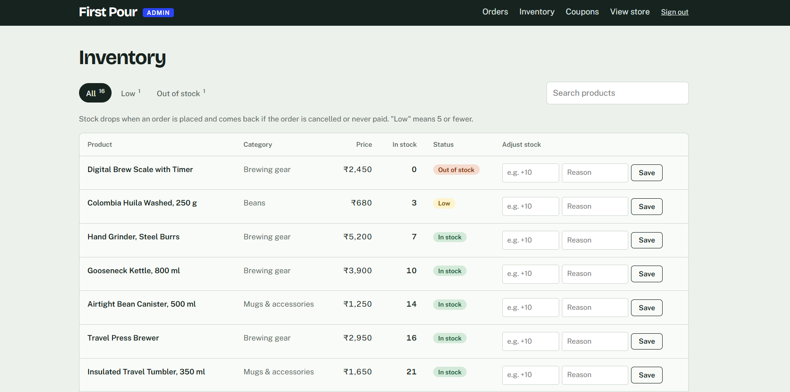

# ☕ First Pour Coffee Co.
### A Full-Stack Coffee E-Commerce Web Application

<p align="center">
  A Flask-powered online coffee store with product browsing, cart management, coupon discounts, checkout, payment testing, order tracking, and inventory administration.
</p>

<p align="center">
  
  
  
  
  
  
</p>

---

## 📌 About the Project

**First Pour Coffee Co.** is a full-stack e-commerce web application designed for an online coffee store. Customers can explore coffee beans and brewing accessories, manage their shopping carts, apply coupons, place orders, and test the payment workflow.

The application also provides an administration interface for managing orders, inventory, stock movements, and promotional coupons.

This project demonstrates practical implementation of backend development, database integration, e-commerce workflows, payment gateway testing, and automated testing.

## ✨ Key Features

### 🛍️ Shopping Experience
- Browse coffee beans and brewing accessories.
- Filter products and identify out-of-stock items.
- View individual product details.
- Add products to the shopping cart and manage quantities.
- Review cart totals and apply coupon codes.

### 🧾 Checkout & Orders
- Complete the checkout workflow.
- Create and review customer orders.
- View order details and track order status.
- Integrate Razorpay in TEST mode for payment workflow testing.

### ⚙️ Admin & Inventory
- Access the administration interface.
- View and manage customer orders.
- Inspect individual order details.
- Monitor inventory and stock movements.
- Manage promotional coupons.

### 🧪 Development & Testing
- SQLite database integration.
- Automated tests using pytest.
- Dockerfile and Docker Compose configuration.
- Environment-based configuration for local development.

## 🖥️ Screenshots

### 1. Store & Product Catalog



### 2. Product Filters & Availability



### 3. Product Details



### 4. Cart & Coupons



### 5. Checkout



### 6. Payment Workflow



### 7. Order Tracking



### 8. Admin Order Management



### 9. Inventory Management



## 🛠️ Technology Stack

| Technology | Usage |
|---|---|
| Python | Backend application logic |
| Flask | Web application framework |
| SQLite | Relational database |
| HTML5 | Page structure |
| CSS3 | Styling and responsive layouts |
| JavaScript | Client-side interactions |
| Razorpay | Payment workflow testing |
| pytest | Automated testing |
| Docker | Containerization support |

## 🏗️ Project Structure

```text
first-pour-coffee/
├── app.py
├── admin.py
├── run.py
├── config.py
├── db.py
├── schema.sql
├── cart_logic.py
├── coupons.py
├── order_service.py
├── payments.py
├── pay.py
├── workflow.py
├── seed_data.py
├── requirements.txt
├── Dockerfile
├── docker-compose.yml
├── templates/
├── static/
│   ├── css/
│   ├── js/
│   └── img/
├── tests/
├── tools/
├── docs/
│   └── screenshots/
├── instance/
├── .gitignore
└── .dockerignore
```

## 🚀 Getting Started

### Prerequisites

- Python installed on your system.
- pip package manager.
- Git.

### 1. Clone the Repository

```bash
git clone https://github.com/ayushi0804/first-pour-coffee.git
cd first-pour-coffee
```

### 2. Create a Virtual Environment

**Windows PowerShell:**

```powershell
python -m venv .venv
.venv\Scripts\Activate.ps1
```

### 3. Install Dependencies

```bash
python -m pip install -r requirements.txt
```

### 4. Configure Environment Variables

Configure the environment variables required by the application in a local `.env` file, if applicable. Use Razorpay TEST credentials for payment testing.

**Never commit `.env` files, private API keys, or payment secrets to GitHub.**

### 5. Start the Application

```bash
python run.py
```

Open the application in your browser:

- **Store:** http://127.0.0.1:5000/
- **Admin:** http://127.0.0.1:5000/admin

Use the admin credentials configured for your local environment, if required.

## 🧪 Running Tests

Run the automated test suite:

```bash
python -m pytest -q
```

The tests cover application workflows and core functionality. Exact coverage depends on the tests included in the repository.

## 🐳 Running with Docker

The repository includes a `Dockerfile` and `docker-compose.yml`.

Build and start the application with:

```bash
docker compose up --build
```

Configure any required environment variables before starting the application.

## 🔐 Security & Payment Notes

- Razorpay is configured for **TEST mode**; this does not imply that live payments are enabled.
- Keep API secrets and environment files private.
- Do not upload virtual environments, local databases, or Python cache directories.
- Configure production security settings before deploying the application publicly.

## 🚀 Future Improvements

- Customer registration and authentication.
- Customer order history and profile management.
- Product reviews and ratings.
- Wishlist functionality.
- Email notifications for order updates.
- Production deployment and live payment configuration.

## 🎯 Learning Outcomes

Through this project, I practiced:

- Developing a web application using Flask.
- Organizing backend code into separate modules.
- Integrating SQLite with application workflows.
- Implementing cart, coupon, checkout, and order-management logic.
- Integrating a payment gateway in test mode.
- Building admin and inventory-management interfaces.
- Writing automated tests with pytest.
- Managing project configuration and Docker files.

## 👩‍💻 Author

**Ayushi Singh**

GitHub: [@ayushi0804](https://github.com/ayushi0804)

**Project Repository:** [First Pour Coffee Co.](https://github.com/ayushi0804/first-pour-coffee)

---

<p align="center">
  ☕ <i>First Pour Coffee Co. — Brewing a better online coffee shopping experience.</i>
</p>
