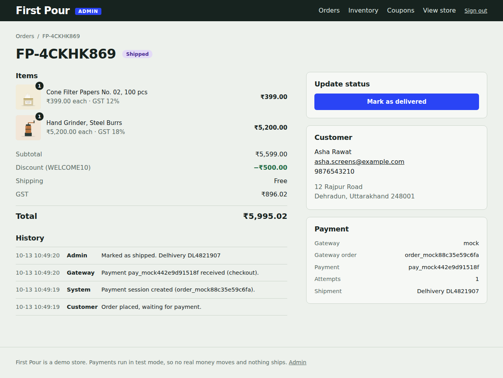
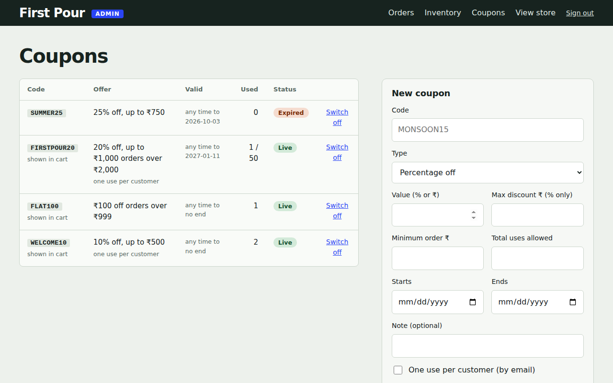
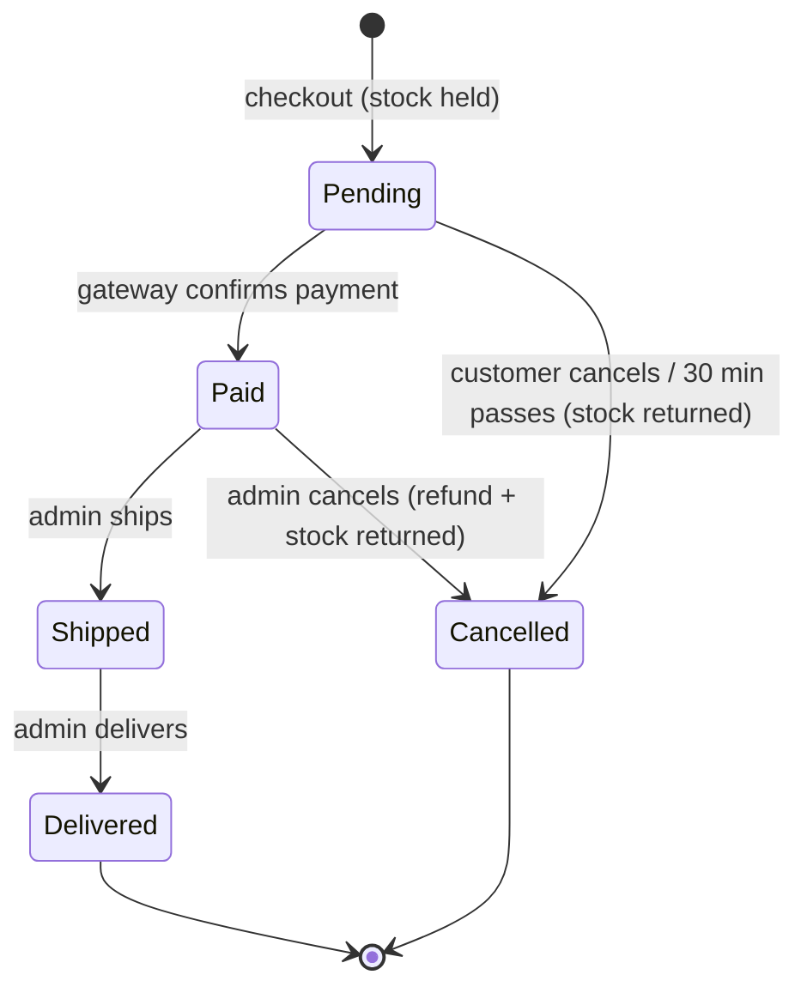

# First Pour Coffee Co.

A complete small online store for coffee gear, beans and mugs, built from scratch with **Flask and SQLite**: product catalog, cart, checkout, **Razorpay payments (test mode)**, an order workflow with an admin area, **inventory tracking** and a **coupon system**.

It runs locally with one command and needs no account or API keys (a built-in payment simulator stands in for Razorpay until you add test keys).

| Shop | Product |
|---|---|
|  |  |
| **Cart with a coupon** | **Checkout** |
|  |  |
| **Payment (test mode)** | **Order tracker** |
|  |  |
| **Admin: orders** | **Admin: inventory** |
|  |  |
| **Admin: order detail** | **Admin: coupons** |
|  |  |

## Run it

You need **Python 3.10 or newer** (developed on 3.12). Pick one option.

### Option 1: one command (no Docker)

```bash
python run.py
```

The first run creates a virtual environment in `.venv`, installs Flask, writes a `.env` with a fresh secret key and a random admin password (printed once in the terminal), creates the database with sample products, and starts the store at **http://127.0.0.1:5000**.

Handy flags: `python run.py --demo` adds sample orders so the admin screens aren't empty, and `python run.py --reset` starts again from a fresh database. On Windows, use `python run.py` or `py run.py`.

### Option 2: Docker

```bash
docker compose up --build
```

Open **http://localhost:5000**. The default admin login for this local demo is `admin` / `admin-demo-1234`. Change it by putting `ADMIN_PASSWORD=...` and `SECRET_KEY=...` in a `.env` file next to `docker-compose.yml`. Data is kept in a Docker volume.

### Option 3: by hand

```bash
python -m venv .venv
source .venv/bin/activate          # Windows: .venv\Scripts\activate
pip install -r requirements.txt
cp .env.example .env               # then set ADMIN_PASSWORD and SECRET_KEY inside
python app.py
```

## Try it (2 minutes)

1. Open the store, add a couple of products, and open the cart.
2. Apply a coupon: **WELCOME10** (10% off, up to ₹500) or **FLAT100** (₹100 off over ₹999). A third, **FIRSTPOUR20**, is 20% off orders over ₹2,000. **SUMMER25** has expired, so it shows the error message.
3. Check out. On the payment page use the simulator, or Razorpay's test details if you added keys (see below). Try the failing option first, then the successful one.
4. Open **/admin** and sign in. Ship the order (carrier and tracking number), refresh the customer's order page to see the tracker move, then mark it delivered.
5. In **Inventory** watch the stock history for the product you bought, and restock something. Make **Colombia Huila Washed** (3 left) go out of stock by buying all three and look at its page.

## Features

**Storefront**
- 16 products in 3 categories with images, prices, descriptions and specs
- Category browsing with live counts, search (every word must match), price range with presets, in-stock filter, 6 sort orders, pagination
- Filters update without a page reload, and the URL always matches what you see (bookmarkable, back button works)
- Sale prices, "New" and "Only N left" labels, and a clear **Out of stock** state: the badge, a disabled button, and no way to add it to the cart

**Cart and checkout**
- Add, remove and change quantity (+/- buttons), kept in the session for 30 days
- Totals with per-category **GST** (5%, 12%, 18%), shipping (free from ₹1,500) and discounts, all in whole paise
- Checkout form with server-side validation (mobile, PIN code, email, state)
- Edge cases handled: empty cart, last item removed, quantity 0 or negative, more than the stock, items selling out while in the cart

**Payments (Razorpay test mode)**
- Orders are saved as *pending*, then paid through Razorpay Checkout. The server checks the signature and confirms the amount with Razorpay before marking the order paid
- A **webhook** marks orders paid even if the customer closes the tab, ignoring repeats
- Failed payments leave the order open for a retry. Unpaid orders are released after 30 minutes. A payment that arrives too late is refunded automatically
- Live keys are refused on purpose: the app won't start with anything but a `rzp_test_` key

**Order workflow and admin** (`/admin`)
- `Pending → Paid → Shipped → Delivered`, or `Cancelled`. Orders can't skip steps, and "Paid" only ever comes from the payment gateway
- Cancelling a paid order refunds it and returns the stock; a failed refund can be retried
- Dashboard numbers, status tabs, search, a full event log for every order, and a progress tracker for the customer

**Inventory**
- Stock **decreases automatically when an order is placed** and returns if the order is cancelled or expires unpaid
- Every change is written to a stock history (order, cancel, restock, correction) so the numbers can always be explained
- Admin inventory page with low-stock and out-of-stock filters, restock/correction with a reason, and a per-product history. Stock can never go below zero, even if two shoppers want the last one

**Coupons**
- Percentage or flat amount, with an optional cap, minimum order, start and end dates, total use limit, and one-use-per-customer (by email)
- Applied in the cart or at checkout, with a clear message when a code can't be used (unknown, expired, minimum not met, fully used, already used)
- The use is counted when the order is placed and given back if the order is cancelled or expires. The last use goes to whoever checks out first
- Admin page to create coupons, switch them on and off, and see how often each was used

**Quality**
- 153 automated tests (totals and tax maths, coupon rules, stock rules, payment signatures and webhooks, the full order workflow, admin access, CSRF)
- CSRF tokens on every form, rate-limited admin sign-in, security headers, a health check at `/healthz`, custom 404/500 pages

## Configuration

Settings come from environment variables or a `.env` file (copy `.env.example`).

| Variable | What it does |
|---|---|
| `SECRET_KEY` | Signs the session cookie. Use a long random value |
| `ADMIN_USER`, `ADMIN_PASSWORD` | Admin login. The admin area is off until a password is set |
| `RAZORPAY_KEY_ID`, `RAZORPAY_KEY_SECRET` | Razorpay **test** keys. Leave empty to use the built-in simulator |
| `RAZORPAY_WEBHOOK_SECRET` | Only needed for the optional webhook |
| `COOKIE_SECURE` | Set to `1` when serving over HTTPS |
| `PORT`, `HOST` | For `python run.py` (default `127.0.0.1:5000`) |

To use the real Razorpay test window, follow [docs/RAZORPAY_SETUP.md](docs/RAZORPAY_SETUP.md). Test details: card `4111 1111 1111 1111` (any future expiry, any CVV), UPI `success@razorpay` or `failure@razorpay`.

## How it works



- **Money** is stored as whole paise, never floats. GST is worked out per line after that line's share of any discount, and the shares are split so they add up exactly.
- **Stock** is taken when the order is placed, inside one database transaction (`BEGIN IMMEDIATE`) that also saves the order and counts the coupon use. If anything fails, nothing is written.
- **Payments** are verified on the server using the order id *it stored*, never one sent by the browser. Webhooks use a separate secret over the raw request body.
- **Orders keep a copy** of names and prices, so an old order always shows what was actually paid.

```
run.py            one-command start        app.py            shop, cart, checkout, order page
cart_logic.py     totals, GST, validation  coupons.py        coupon rules (dates, limits, once per customer)
order_service.py  everything that changes an order or stock
workflow.py       the status rules         payments.py       Razorpay + local simulator
pay.py            pay page, verify, webhook   admin.py       admin screens
db.py, schema.sql, seed_data.py            templates/, static/        pages, CSS, JS
tests/            153 tests                tools/             demo data, screenshots, image generator
```

## Tests

```bash
python -m unittest discover tests
```

## Notes and limitations

- It's a demo store: payments are test mode only, no emails are sent, and there are no customer accounts (customers see their order through its random order number).
- SQLite is plenty for this size. For a real deployment you'd move to PostgreSQL, add emails, and put it behind HTTPS.
- The product images are drawn illustrations. To use photos, see [PHOTOS.md](PHOTOS.md).
- The local payment simulator keeps its state in memory, so Docker runs one worker.

## Troubleshooting

- **"Could not install the requirements"**: check your internet connection, or run `pip install -r requirements.txt` yourself.
- **Admin says it's switched off**: set `ADMIN_PASSWORD` in `.env` and restart.
- **Razorpay window doesn't open**: make sure the keys start with `rzp_test_`, you restarted after editing `.env`, and nothing blocks `checkout.razorpay.com`.
- **Port 5000 is busy** (common on macOS): `PORT=5001 python run.py`.
- **Start fresh**: `python run.py --reset`.

## Retaking the screenshots

With the store running (`python run.py --demo`): `pip install playwright && playwright install chromium && python tools/screenshots.py`.

## What I learned

(Write this part yourself: what was hard, what you fixed, what you would add next.)
